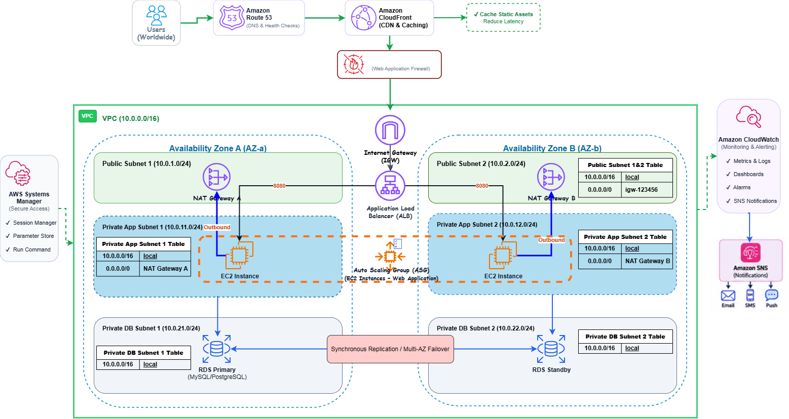

# 🚀 High-Availability & Scalable Web Application on AWS

A production-oriented reference architecture for deploying a scalable web application on AWS. The design separates edge delivery, application compute, and database services; places EC2 instances in private subnets; and uses two Availability Zones to reduce single-AZ dependency.

Repository scope: This repository contains the architecture diagram and project documentation. It does not claim that the infrastructure has already been deployed, and it does not yet include Terraform/CloudFormation implementation code. Deployment evidence, measured performance, and actual cost figures should be added after the environment is built and tested.

---

## 📑 Table of Contents

1. [Project Overview](#-project-overview)
2. [System Architecture Diagram](#-system-architecture-diagram)
3. [Infrastructure & Component Breakdown](#-infrastructure--component-breakdown)
   - [1. Network Layer (VPC & Subnet Topology)](#1-network-layer-vpc--subnet-topology)
   - [2. Edge & Perimeter Security Layer (Route 53, CloudFront & WAF)](#2-edge--perimeter-security-layer-route-53-cloudfront--waf)
   - [3. Load Balancing & Compute Layer (ALB & ASG)](#3-load-balancing--compute-layer-alb--asg)
   - [4. Data & Persistence Layer (Amazon RDS Multi-AZ)](#4-data--persistence-layer-amazon-rds-multi-az)
   - [5. Secure Administration & Governance (AWS Systems Manager)](#5-secure-administration--governance-aws-systems-manager)
   - [6. Observability & Telemetry (CloudWatch & SNS)](#6-observability--telemetry-cloudwatch--sns)
4. [Chained Security Groups Matrix](#-chained-security-groups-matrix)
5. [End-to-End Traffic Flow](#-end-to-end-traffic-flow)
6. [Disaster Recovery & SLA Strategy](#-disaster-recovery--sla-strategy)
7. [License](#-license)

---

## 🎯 Project Overview

This project provides an enterprise-ready, automated infrastructure baseline engineered for latency-sensitive, mission-critical web applications requiring continuous uptime:

* **Complete Isolation of Sensitive Compute:** All application runtimes and database nodes are strictly placed inside private subnets with no direct inbound ingress from the public internet.
* **Fault Tolerance & Redundancy:** Workloads are evenly distributed across two Availability Zones (`AZ-a` and `AZ-b`) with synchronous database replication and dedicated NAT Gateways per AZ.
* **Dynamic Elastic Scaling:** Infrastructure scales horizontally based on real-time traffic volume and compute pressure, cutting idle costs while effortlessly handling peak load spikes.
* **Zero-Trust Access (No SSH):** TCP Port 22 is completely closed across all security perimeters. Server management is handled exclusively via AWS Systems Manager Session Manager with comprehensive audit logging.

---

## 🏛 System Architecture Diagram

The diagram below illustrates the end-to-end data flow from global end-users through AWS Edge services, load balancing, private compute tiers, and resilient persistence layers:



```text
[Users Worldwide]
       │
       ▼ (DNS Anycast Query)
[Amazon Route 53] ──► [Amazon CloudFront] ──(Cache Static Assets)──► [S3 Bucket / Edge Cache]
                             │
                             ▼ (OWASP Top 10 Inspection)
                      [AWS WAF]
                             │
                             ▼ (HTTPS + Custom Header: X-Origin-Verify)
                   [Internet Gateway (IGW)]
                             │
            ┌────────────────┴────────────────┐
            ▼                                 ▼
   [Public Subnet 1]                 [Public Subnet 2]
     ├── ALB Listener (Port 443)       ├── ALB Listener (Port 443)
     └── NAT Gateway A                 └── NAT Gateway B
            │                                 │
            └──────────────┬──────────────────┘
                           │ (HTTP :8080 - Restricted to ALB-SG)
       ┌───────────────────┴───────────────────┐
       ▼                                       ▼
[Private App Subnet 1]               [Private App Subnet 2]
 ├── EC2 App Instance (AZ-a)          ├── EC2 App Instance (AZ-b)
 └── Outbound via NAT-A               └── Outbound via NAT-B
       │                                       │
       └───────────────┬───────────────────────┘
                       │ (Port 3306/5432 - Restricted to EC2-SG)
       ┌───────────────┴───────────────────────┐
       ▼                                       ▼
[Private DB Subnet 1]                [Private DB Subnet 2]
 └── RDS Primary (Read/Write)  ◄════► └── RDS Standby (Sync Replica)
```

---

## 🔧 Infrastructure & Component Breakdown

### 1. Network Layer (VPC & Subnet Topology)

* **VPC CIDR:** `10.0.0.0/16` partitioned across 6 dedicated subnets (3 functional tiers across 2 Availability Zones):

| Subnet Name | CIDR Block | Availability Zone | Type | Purpose & Hosted Components |
| :--- | :--- | :--- | :--- | :--- |
| `public-subnet-1` | `10.0.1.0/24` | `AZ-a` | Public | Application Load Balancer, NAT Gateway A |
| `public-subnet-2` | `10.0.2.0/24` | `AZ-b` | Public | Application Load Balancer, NAT Gateway B |
| `private-app-subnet-1` | `10.0.11.0/24` | `AZ-a` | Private | EC2 Application Instances (ASG) |
| `private-app-subnet-2` | `10.0.12.0/24` | `AZ-b` | Private | EC2 Application Instances (ASG) |
| `private-db-subnet-1` | `10.0.21.0/24` | `AZ-a` | Private Isolated | Amazon RDS Primary Instance |
| `private-db-subnet-2` | `10.0.22.0/24` | `AZ-b` | Private Isolated | Amazon RDS Standby Replica |

#### Route Tables:
* **Public Route Table:**
  * `10.0.0.0/16` $\rightarrow$ `local`
  * `0.0.0.0/0` $\rightarrow$ `Internet Gateway (igw-xxxx)`
* **Private App Route Table 1:**
  * `10.0.0.0/16` $\rightarrow$ `local`
  * `0.0.0.0/0` $\rightarrow$ `NAT Gateway A` (Dedicated to `AZ-a`)
* **Private App Route Table 2:**
  * `10.0.0.0/16` $\rightarrow$ `local`
  * `0.0.0.0/0` $\rightarrow$ `NAT Gateway B` (Dedicated to `AZ-b`)
* **Private DB Route Table:**
  * `10.0.0.0/16` $\rightarrow$ `local` *(Completely isolated with zero external routes)*

---

### 2. Edge & Perimeter Security Layer (Route 53, CloudFront & WAF)

* **Amazon Route 53:**
  * Zone management using **Alias Records (A/AAAA)** pointing domain traffic directly to the CloudFront distribution.
  * Active health checks to monitor upstream availability.
* **Amazon CloudFront:**
  * Global edge caching for static assets (`/static/*`, `/assets/*`) to offload traffic from backend compute and minimize latency.
  * Injects a cryptographically generated secret header (`X-Origin-Verify`) into every origin request forwarded to the ALB.
* **AWS WAF (Web Application Firewall):**
  * Integrated directly with CloudFront to mitigate malicious traffic at the edge:
    * `AWSManagedRulesCommonRuleSet` (Guards against OWASP Top 10: SQLi, XSS, Command Injection).
    * `AWSManagedRulesKnownBadInputsRuleSet` (Blocks known exploit vectors).
    * `Rate-based Rule` (Limits requests to 500 per IP across 5-minute rolling windows to stop HTTP Flood/DDoS).

---

### 3. Load Balancing & Compute Layer (ALB & ASG)

#### Application Load Balancer (ALB)
* **Subnet Association:** Spans across `public-subnet-1` and `public-subnet-2`.
* **Listeners & Routing:**
  * **HTTP (Port 80):** Strict 301 permanent redirect to HTTPS.
  * **HTTPS (Port 443):** Terminated using ACM-issued TLS certificates with `ELBSecurityPolicy-TLS13-1-2-2021-06`.
* **Origin Header Verification:** Drops any request that fails to present the correct `X-Origin-Verify` header, neutralizing origin-bypass attacks.
* **Target Group:** Evaluates instance viability via `/health` health check endpoints (expects HTTP 200).

#### Auto Scaling Group (ASG) & Launch Template
* **Launch Template Configuration:**
  * **AMI:** Amazon Linux 2023 Minimal (Hardened).
  * **Instance Type:** `t3.medium` or `c7g.medium` (AWS Graviton3).
  * **Storage:** 30 GB `gp3` root EBS volume encrypted with customer-managed AWS KMS keys.
  * **IAM Instance Profile:** Attached with `AmazonSSMManagedInstanceCore` and `CloudWatchAgentServerPolicy`.
* **Capacity Thresholds:**
  * Minimum: `2`
  * Desired: `2`
  * Maximum: `8`
* **Target Tracking Scaling Policies:**
  * `ASGAverageCPUUtilization` maintained at **65%**.
  * `ALBRequestCountPerTarget` maintained at **1500 requests/target**.

---

### 4. Data & Persistence Layer (Amazon RDS Multi-AZ)

* **Engine:** Amazon RDS for MySQL 8.0 / PostgreSQL 16 in a **Multi-AZ Deployment**.
* **Replication Architecture:** High-throughput synchronous block-level replication from the Primary instance in `AZ-a` to the Standby replica in `AZ-b`.
* **Automatic Failover:** Automatic DNS failover handles node or infrastructure failures within 60–120 seconds with zero manual intervention or application configuration updates.
* **Data Protection:**
  * Storage encryption at rest via AWS KMS (AES-256).
  * Automated daily snapshots with 14-day retention and Point-in-Time Recovery (PITR).

---

### 5. Secure Administration & Governance (AWS Systems Manager)

* **Elimination of Bastion Hosts:** TCP Port 22 is disabled globally across all network tiers.
* **SSM Session Manager:**
  * Grants encrypted, credential-free terminal shell access via the AWS Console or AWS CLI.
  * Streams command history, execution logs, and output streams directly to Amazon CloudWatch Logs and an encrypted S3 audit bucket.
* **AWS Systems Manager Parameter Store:** Centrally manages sensitive application variables, database credentials, and API tokens as encrypted `SecureString` parameters.

---

### 6. Observability & Telemetry (CloudWatch & SNS)

* **Amazon CloudWatch Agent:** Deployed on all instances to collect fine-grained OS metrics (RAM utilization, disk metrics, and swap usage).
* **CloudWatch Alarms:**
  * High CPU utilization alarm (Triggered if Average CPU > 80% for 5 consecutive minutes).
  * ALB Target 5XX Error alarm (Triggered if error count > 10 errors/minute).
  * RDS Free Storage Space alarm (Triggered if remaining disk space < 20%).
* **Amazon SNS (Simple Notification Service):** Dispatches real-time critical incidents to operations email endpoints and on-call engineering Slack webhooks.

---

## 🛡 Chained Security Groups Matrix

The network enforces the principle of least privilege using programmatic Security Group references (Chaining), avoiding static IP definitions within the VPC:

| Security Group | Direction | Protocol / Port | Source / Destination | Functional Purpose |
| :--- | :--- | :--- | :--- | :--- |
| **`ALB-SG`** | Inbound | TCP 80, 443 | `0.0.0.0/0` (or CloudFront Prefix List) | Ingest public client web traffic |
| **`ALB-SG`** | Outbound | TCP 8080 | `EC2-SG` (Security Group ID) | Forward traffic exclusively to backend instances |
| **`EC2-SG`** | Inbound | TCP 8080 | `ALB-SG` (Security Group ID) | Accept traffic strictly originating from the ALB |
| **`EC2-SG`** | Outbound | TCP 443 | `0.0.0.0/0` (via NAT Gateways) | Outbound package updates and SSM connectivity |
| **`EC2-SG`** | Outbound | TCP 3306 / 5432 | `RDS-SG` (Security Group ID) | Send database queries to the persistence tier |
| **`RDS-SG`** | Inbound | TCP 3306 / 5432 | `EC2-SG` (Security Group ID) | Permit queries exclusively from application nodes |
| **`RDS-SG`** | Outbound | All | *None (All Outbound Blocked)* | Isolate database tier from establishing outbound calls |

---

## 🔄 End-to-End Traffic Flow

### 1. Dynamic Web Request Flow
```text
Client Request (HTTPS:443)
       │
       ▼
Amazon Route 53 (Resolves domain to CloudFront Anycast IP)
       │
       ▼
Amazon CloudFront (Evaluates cache, injects X-Origin-Verify header)
       │
       ▼
AWS WAF (Inspects and filters against OWASP Top 10 rules)
       │
       ▼
Internet Gateway (Transit boundary into the AWS VPC)
       │
       ▼
Application Load Balancer (Terminates TLS, validates origin header, routes to Target Group)
       │
       ▼ (Forwarded over HTTP:8080)
EC2 Instance in Private App Subnet (Application logic execution)
       │
       ▼ (Database Query over TCP:3306/5432)
Amazon RDS Primary Database (Executes transaction & syncs to Standby replica)
       │
       ▼
Response traverses identical reverse path back to the client.
```

### 2. Outbound Node Egress Flow
```text
EC2 Instance (Private Subnet) ──► Private Route Table ──► NAT Gateway (Public Subnet) ──► Internet Gateway ──► Upstream Repositories (GitHub, OS Mirrors)
```

## ⏱ Disaster Recovery & SLA Strategy

| Failure Scenario | Detection & Mitigation Mechanism | RPO (Data Loss) | RTO (Recovery Time) |
| :--- | :--- | :--- | :--- |
| **Single EC2 Node Failure** | ALB Target Group health check fails; ASG terminates and replaces the node automatically. | 0 seconds | < 3 minutes |
| **Full AZ Outage (`AZ-a` or `AZ-b`)** | ALB shifts 100% of ingress to the remaining healthy AZ; ASG scales instances up in the surviving AZ. | 0 seconds | Immediate (Seamless) |
| **Primary Database Hardware Failure** | RDS internal health monitor initiates automated failover to the synchronous Standby node. | 0 seconds (Synchronous replication) | 60 – 120 seconds |
| **DDoS / HTTP Flood Attack** | AWS WAF rate-limiting rules block malicious IPs at the edge before hitting the origin. | N/A | Real-time mitigation |

---

## 📜 License

This project is open-source software licensed under the [MIT License](LICENSE).