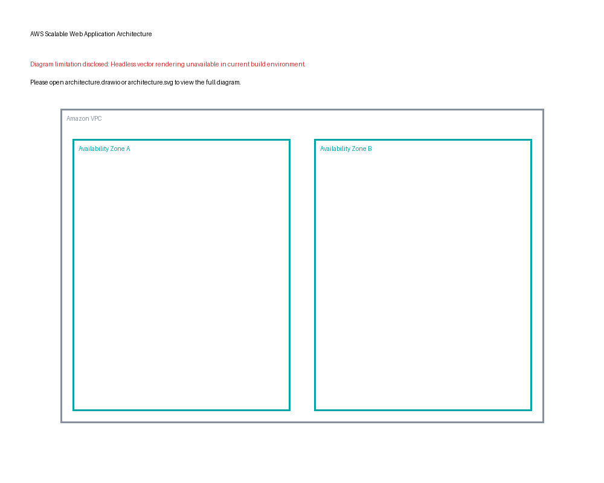
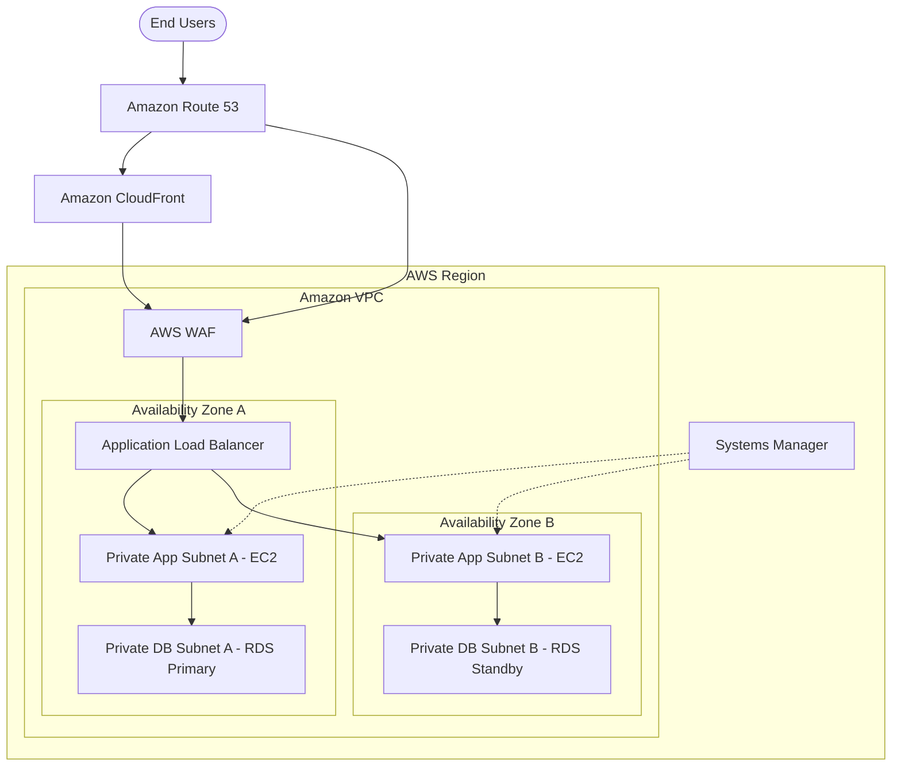

# Scalable Web Application with ALB and Auto Scaling
A professionally documented, EC2-based scalable and highly available AWS web application architecture featuring Amazon VPC, Application Load Balancer, EC2 Auto Scaling, CloudFront, AWS WAF, RDS Multi-AZ, Route 53, Systems Manager, CloudWatch, and SNS.

## Table of Contents
- [Solution Overview](#solution-overview)
- [Project Objectives](#project-objectives)
- [Architecture Diagram](#architecture-diagram)
- [AWS Architecture and Core Services](#aws-architecture-and-core-services)
- [Network Architecture and Traffic Flow](#network-architecture-and-traffic-flow)
- [Security Architecture](#security-architecture)
- [High Availability and Fault Tolerance](#high-availability-and-fault-tolerance)
- [Auto Scaling Strategy](#auto-scaling-strategy)
- [CloudFront Caching Strategy](#cloudfront-caching-strategy)
- [Implementation Overview and Configuration](#implementation-overview-and-configuration)
- [Monitoring and Operational Visibility](#monitoring-and-operational-visibility)
- [Validation and Testing](#validation-and-testing)
- [Deployment Prerequisites](#deployment-prerequisites)
- [Repository Structure](#repository-structure)
- [Implementation History and Evidence Limitations](#implementation-history-and-evidence-limitations)
- [Limitations and Design Considerations](#limitations-and-design-considerations)
- [References](#references)
- [External Contributors](#external-contributors)

## Solution Overview
This project presents an EC2-based scalable web application architecture across two Availability Zones. It ensures high availability, fault tolerance, and scalability. Application EC2 instances are isolated in private subnets, accessed only via an internet-facing Application Load Balancer. Static assets are delivered securely via CloudFront, while dynamic requests are inspected by AWS WAF. 

## Project Objectives
- Architect a highly available, fault-tolerant AWS web application.
- Implement robust network isolation using private subnets.
- Reconstruct the architectural documentation of a historically deployed solution.

## Architecture Diagram

Editable diagram sources:
- [Draw.io Source](docs/architecture/architecture.drawio)
- [SVG Vector](docs/architecture/architecture.svg)
- [Mermaid Syntax](docs/architecture/architecture.mmd)

## AWS Architecture and Core Services
### Amazon VPC and Networking
**Reconstructed Architecture:** A VPC distributed across two Availability Zones utilizing a three-tier subnet architecture (Public, Private Application, Private Database). 
### Availability Zones and Subnets
**Proposed Reference Configuration:** Resources distributed across AZ A and AZ B. Public subnets host NAT Gateways and the ALB. 
### Application Load Balancer
**User-Reported Implementation:** Internet-facing ALB in public subnets routing traffic to EC2 instances in private subnets. 
### Amazon EC2 and Auto Scaling
**Reconstructed Architecture:** Auto Scaling Group spanning two AZs using an EC2 Launch Template with Target Tracking Scaling Policies.
### Amazon CloudFront
**Reconstructed Architecture:** Distributes static content with an ALB origin. 
### AWS WAF
**Reconstructed Architecture:** A Regional Web ACL associated with the Application Load Balancer to protect against common web exploits. 
### Amazon RDS Multi-AZ
**User-Reported Implementation:** Relational database backend configured with Multi-AZ for high availability. 
### Amazon Route 53
**User-Reported Implementation:** Main DNS routing with an Alias record pointing to the ALB. 
### AWS Systems Manager
**Reconstructed Architecture:** Session Manager provides secure, Bastion-free administrative access to private EC2 instances. 
### Amazon CloudWatch and Amazon SNS
**User-Reported Implementation:** Centralized monitoring and alerting architecture.

## Network Architecture and Traffic Flow
Traffic from the user hits Route 53, resolving to the CloudFront distribution for static assets or directly to the ALB for dynamic traffic. The ALB (in public subnets) forwards requests to EC2 instances (in private subnets). EC2 instances communicate with the Multi-AZ RDS cluster in isolated database subnets. Outbound internet access for EC2 instances traverses the NAT Gateways.

## Security Architecture
**Reconstructed Architecture:** Incorporates least-privilege IAM roles, security groups, stateless NACLs, and strict subnet isolation. EC2 instances and RDS databases are protected from direct internet access.

## High Availability and Fault Tolerance
**User-Reported Implementation / Reconstructed Architecture:** High availability is achieved by deploying resources across two AZs. The ALB performs health checks on targets. Auto Scaling replaces unhealthy instances, and RDS provides automated Multi-AZ failover.

## Auto Scaling Strategy
**Proposed Reference Configuration:** Target Tracking Scaling Policy based on CPU Utilization or ALB Request Count per Target. 

## CloudFront Caching Strategy
**Recommended Improvement:** Cache static assets at edge locations. Cache behaviors define TTLs for static assets, while dynamic requests are configured as cache misses passed to the ALB origin.

## Implementation Overview and Configuration
**User-Reported Implementation:**
1. Provisioned VPC, Subnets, IGW, and NAT Gateways.
2. Configured Security Groups and NACLs.
3. Created ALB, Target Groups, and Launch Templates.
4. Deployed Auto Scaling Group.
5. Configured RDS Multi-AZ.
6. Setup CloudFront, WAF, and Route 53.
7. Enabled CloudWatch monitoring and SNS alerts.
*Configuration Not Available: Specific historical CIDRs, instance types, and naming conventions.*

## Monitoring and Operational Visibility
**Proposed Reference Configuration:** CloudWatch Dashboards visualizing ALB RequestCount, EC2 CPUUtilization, and RDS FreeStorageSpace. 

## Validation and Testing
| Test Objective | Recommended Test Procedure | Expected Result | Historical Verification Status | Evidence Availability |
|---|---|---|---|---|
| App Accessibility | Access ALB endpoint via HTTPS | HTTP 200 OK | Passed (Reported) | Not Available |
| Target Group Health | Force EC2 failure | ALB deregisters instance | Passed (Reported) | Not Available |
| Auto Scaling | Increase CPU load | ASG launches new instances | Passed (Reported) | Not Available |
| RDS Failover | Reboot RDS primary | Standby becomes primary | Passed (Reported) | Not Available |

## Deployment Prerequisites
To reconstruct this environment, you need an AWS Account, Administrator IAM permissions, an existing Route 53 Hosted Zone, and appropriate application artifacts.

## Repository Structure
- `/docs/architecture/`: Diagram files (PNG, SVG, Draw.io, Mermaid).
- `/docs/networking/`, `/docs/security/`, etc.: Deep-dive architectural documentation.

## Implementation History and Evidence Limitations
**Configuration Not Available:** This project was previously implemented, but original AWS resources were deleted. The architecture documented here is a *Reconstructed Architecture* based on project descriptions. Original resource configurations (IDs, specific rules, thresholds) are unavailable and not independently verified.

## Limitations and Design Considerations
**Cost Optimization Considerations:** The proposed reference design uses two NAT Gateways and RDS Multi-AZ, which incur higher base costs but are required for high availability. 

## References
- [Amazon VPC](https://docs.aws.amazon.com/vpc/)
- [Amazon EC2 Auto Scaling](https://docs.aws.amazon.com/autoscaling/)
- [AWS Well-Architected Framework](https://aws.amazon.com/architecture/well-architected/)

## External Contributors
Authored and reconstructed by Principal AWS Solutions Architect. No external fictitious contributors claimed.
